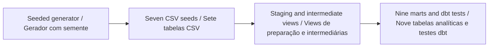

# People Analytics Data Warehouse

### Data Warehouse de People Analytics

[](https://github.com/galafis/people-analytics-dwh-dbt/actions/workflows/ci.yml)
[English](#english) · [Português](#portugues) · [Examples / Exemplos](examples/review_demo.py) · [Validation / Validação](docs/VALIDATION.md)

**Data engineering / Engenharia de dados** · Working prototype / Protótipo funcional · Gabriel Demetrios Lafis

<a id="english"></a>

## English

Generate seven related synthetic workforce tables and transform them into a local analytical warehouse with dbt and DuckDB.

### What works

- Seeded employee lifecycle, payroll, absences, promotions, training, surveys and recruiting data.
- Seven staging views, five intermediate views and nine analytical tables with lineage through dbt references.
- Python data contracts and database tests cover identifiers, relationships, required fields and metric bounds.

### Reproducible walkthrough

Requirements: Python 3.12 / Python 3.12.

Run from the repository root. The validation environment installs the components exercised by the tests and documented example; optional integrations may need their separate dependencies.

```sh
python -m venv .venv
# Activate .venv for your shell / Ative .venv no seu terminal
python -m pip install -r requirements-validation.txt
python -m pytest -q
python -m examples.review_demo
```

**Input contract / Contrato de entrada:** 7 CSV tables / 7 tabelas CSV; seed / semente `42`; 200 synthetic employees / participantes fictícios.

**Expected behavior / Comportamento esperado:** Seven generated tables; referential integrity is checked before the example summary is printed. / Sete tabelas geradas; a integridade referencial é verificada antes da impressão do resumo.

### Architecture / Arquitetura



The main path can be followed in [src/generate_data.py](src/generate_data.py). Examples call the actual implementation and include assertions; they are not pseudocode.

### Scope and assumptions

All records are synthetic and distributions are illustrative assumptions. Metric definitions are teaching choices, not a validated HR benchmark. Payroll is a simplified monthly model, not a payroll compliance engine.

### Changes verified in this review

Fixed nullable termination dates that prevented active employees from generating downstream data; added population and date-range validation.

<a id="portugues"></a>

## Português

Gere sete tabelas fictícias relacionadas e transforme-as em um ambiente analítico local com dbt e DuckDB.

### Funcionalidades disponíveis

- Dados com semente fixa de vínculos, folha, ausências, promoções, treinamentos, pesquisas e recrutamento.
- Sete views de preparação, cinco intermediárias e nove tabelas analíticas com linhagem por referências dbt.
- Contratos Python e testes de banco cobrem identificadores, relacionamentos, campos obrigatórios e limites de métricas.

### Execução reproduzível

Use os comandos da seção acima a partir da raiz do repositório. Requisitos: Python 3.12 / Python 3.12. O ambiente de validação instala os componentes exercitados pelos testes e pelo exemplo documentado; integrações opcionais podem exigir dependências próprias.

O fluxo principal está em [src/generate_data.py](src/generate_data.py). Os exemplos usam a implementação real e verificam resultados com asserções; não são pseudocódigo. O diagrama apresenta os mesmos passos nos dois idiomas.

### Escopo e premissas

Todos os registros são fictícios e as distribuições são hipóteses ilustrativas. As métricas são escolhas didáticas, sem validação como referência de RH. A folha é um modelo mensal simplificado, sem cálculo de obrigações legais.

### Melhorias verificadas nesta revisão

Corrigidas datas de desligamento nulas que impediam gerar dados de participantes ativos; adicionada validação de população e intervalo de datas.

### Build the warehouse / Construir o warehouse

```sh
python -m src.generate_data --n-employees 200
cd dbt_project
dbt deps
dbt build --profiles-dir . --target ci
```

EN: The `ci` target uses an in-memory database for one complete build. Use `--target dev` for a file-backed warehouse. Tenure and age use `as_of_date` (default `2024-12-31`). Turnover uses ending headcount as its simplified denominator and returns zero when that denominator is zero. The example period is 2019–2024; keep generator dates and SQL reporting dates aligned when customizing it.

PT: O destino `ci` usa banco em memória durante uma execução completa. Use `--target dev` para persistir em arquivo. Tempo de vínculo e idade usam `as_of_date` (padrão `2024-12-31`). Turnover usa a contagem ao final do mês como denominador simplificado e devolve zero quando esse denominador é zero. O período do exemplo é 2019–2024; mantenha alinhadas as datas do gerador e do relatório SQL ao personalizar.

## Repository guide / Guia do repositório

| Location / Local                                            | Purpose / Finalidade                                                   |
| ----------------------------------------------------------- | ---------------------------------------------------------------------- |
| [Implementation / Implementação](src/generate_data.py)      | Main domain behavior / Comportamento principal do domínio              |
| [Example / Exemplo](examples/review_demo.py)                | Executable scenario / Cenário executável                               |
| [Tests / Testes](tests/)                                    | Normal behavior and failure cases / Fluxos válidos e casos de falha    |
| [Validation notes / Notas de validação](docs/VALIDATION.md) | Corrections, evidence and boundaries / Correções, evidências e limites |
| [Workflow / Automação](.github/workflows/ci.yml)            | Automated checks / Verificações automatizadas                          |

- [Executed example result / Resultado executado do exemplo](examples/expected.json)

## Development / Desenvolvimento

EN: When changing behavior, update the contract, the worked example and a regression test together. Keep synthetic fixtures separate from real data. A passing test suite demonstrates the listed software behaviors; it does not certify a deployment or domain outcome.

PT: Ao alterar comportamento, atualize em conjunto o contrato, o exemplo e um teste de regressão. Separe amostras fictícias de dados reais. Testes aprovados demonstram os comportamentos de software listados; não certificam implantação nem resultado no domínio.

Author / Autor: [Gabriel Demetrios Lafis](https://github.com/galafis) · [Institutional contact / Contato institucional](mailto:gabrieldemetrioslafis@usp.br)

License / Licença: [repository license](LICENSE).
